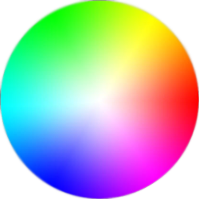
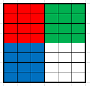
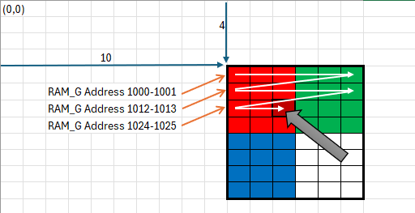
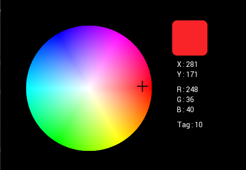
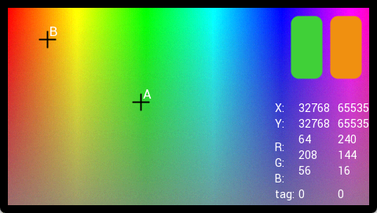
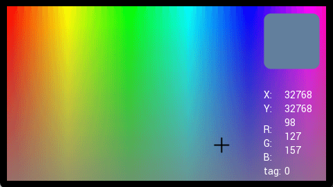
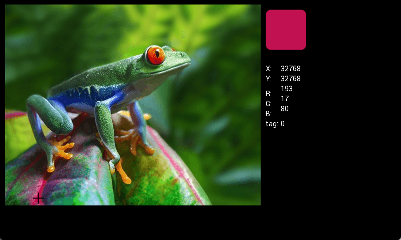

# EVE-MCU-Dev Colour Picker Example

[Back](../README.md)

## Colour Picker Example

The `colourpicker` example demonstrates several examples of implementing a colour picker or colour wheel
using the EVE family of devices. 



Colour pickers allow the user to select a colour by touching a particular pixel of an image displayed
on the screen. They help to make selection of the colour within an application friendly and intuitive
for the end user. They are often used in applications such as lighting or where the application
designer wants to allow the user to customise colours of on-screen items with a wide selection of
colours. In addition, the technique used also allows applications where the end user can test the
colour of parts of an image such as a photograph.

The selected colour and it's RGB value is displayed on the screen.

### Scope

This application note is intended to demonstrate simple techniques for implementing colour pickers
on the Bridgetek EVE devices. It focuses on the colour picker operation and assumes that
the user is familiar with the basic principles of developing touch-enabled applications for EVE and
with programming MCUs. 

### Compatibility

The code has been tested on the various MCUs, emulators and Platforms.

#### EVE API Support

Supported EVE APIs in this example:

| EVE API 1 | EVE API 2 | EVE API 3 | EVE API 4 | EVE API 5 |
| --- | --- | --- | --- | --- |
| Yes | Yes | Yes | Yes | Yes |


#### Platform Support

This example supports the following platforms:

| Port Name | Port Directory | 
| --- | --- | 
| [Raspberry Pi Pico](pico/README.md) | [pico](pico/) |
| [PlatformIO with Arduino Framework](platformio_arduino/README.md) | [platformio_arduino](platformio_arduino/) |
| [Generic using libFT4222](libft4222/README.md) | [libft4222](libft4222/) |
| [Generic using EVE Emulator](emulator/README.md) | [emulator](emulator/) |

Platform specific build instructions and setup requirements are shown in the `README.md` file in the platform build directory.

### Common Files and Folders

The example contains a common directory with several files which comprises all the colour picker functionality.

| File/Folder | Description |
| --- | --- |
| [common/eve_example.c](common/eve_example.c) | Example source code main file. |
| [common/eve_example.h](common/eve_example.h) | Header file with definitions and configuration settings for the example. |
| [common/colour_wheel.c](common/colour_wheel.c) | Source code for [Colour Wheel Example](#colour-wheel-example). |
| [common/argb1555_multi.c](common/argb1555_multi.c) | Source code [ARGB1555 Multi-touch Example](#argb1555-multitouch-example). |
| [common/paletted8.c](common/paletted8.c) | Source code for [Paletted Rectangle Example](#paletted-rectangle-example) and [Paletted Image Example](#paletted-image-example). |
| [common/image_paletted_data.c](common/image_paletted_data.c) | Image data for [Paletted Image Example](#paletted-image-example). |
| [common/rect_paletted_data.c](common/rect_paletted_data.c) | Image data for [Paletted Rectangle Example](#paletted-rectangle-example). |
| [docs](docs) | Documentation support files. |
| [images](images) | Source images used in this example. |


## Using an Image as a Colour Picker

The examples presented in this example are all based around the principle of displaying an
image, which is stored as a raw data format in RAM_G, on the screen and allowing the user to
select a point on the image. The colour of that pixel is then read and displayed.

Any image can be used depending on the intended application, but one common use case is to
display a colour gradient image which then allows the user to select from a wide range of colours. 

The **four** colour picker methods using shown in this example are:

| Name | Method | Description |
| --- | --- | --- |
| [Colour Wheel Example](#colour-wheel-example) | Decodes an ARGB1555 image. | The image is generated programmatically. A circular image is used and displayed on screen. |
| [ARGB1555 Multi-touch Example](#argb1555-multitouch-example) | Decodes an ARGB1555 image with 2 touchable points. | The rectangular image is stored as an ARGB1555 compressed bitmap and loaded to `RAM_G`. There are 2 touch points supported and are separately decoded. |
| [Paletted Rectangle Example](#paletted-rectangle-example) | Decodes a Paletted rectangular image. | The paletted image is compressed and loaded to `RAM_G`. A single touch point is decoded. |
| [Paletted Image Example](#paletted-image-example) | Decodes a Paletted arbitary image. | The paletted image is compressed and loaded to `RAM_G`. A single touch point is decoded. |


### Image Data Formats

When EVE displays an image in one of the raw data formats (such as PALETTED, ARGB1555 or RGB332 or
RGB565) the image data is read in real time from RAM_G. Depending on the format used, there
will be one or more bytes of data in RAM_G for each pixel.

### ARGB1555 Formats

The data array itself looks like one continuous one-dimensional block of values. EVE can combine
this data with the knowledge of the format used and the width (leading to how many bytes
represent each line of the image) and the height to produce a two-dimensional image.

In the same way, it is possible for the colour picker application to relate a particular pixel on the
image back to the byte(s) in the data array in RAM_G which represent that pixel. From this, the
colour can be determined.

For example, in an ARGB1555 image which is 6 pixels wide by 8 pixels tall, the image and data
may look as shown below:



The ARGB1555 format uses the following data for each pixel. This includes 5 bits per colour (R, G,
B) and an additional alpha bit (A) which allows for transparency of that pixel.

`ARRR RRGG GGGB BBBB`

As ARGB1555 uses 2 bytes per pixel and the width and height are known, the relationship between
the data and the image can be shown more clearly below.

```c
uint8_t data [] = {
    0x00, 0xfc, 0x00, 0xfc, 0x00, 0xfc, 0xe0, 0x83, 0xe0, 0x83, 0xe0, 0x83,
    0x00, 0xfc, 0x00, 0xfc, 0x00, 0xfc, 0xe0, 0x83, 0xe0, 0x83, 0xe0, 0x83,
    0x00, 0xfc, 0x00, 0xfc, 0x00, 0xfc, 0xe0, 0x83, 0xe0, 0x83, 0xe0, 0x83,
    0x00, 0xfc, 0x00, 0xfc, 0x00, 0xfc, 0xe0, 0x83, 0xe0, 0x83, 0xe0, 0x83,
    0x1f, 0x80, 0x1f, 0x80, 0x1f, 0x80, 0xff, 0xff, 0xff, 0xff, 0xff, 0xff,
    0x1f, 0x80, 0x1f, 0x80, 0x1f, 0x80, 0xff, 0xff, 0xff, 0xff, 0xff, 0xff,
    0x1f, 0x80, 0x1f, 0x80, 0x1f, 0x80, 0xff, 0xff, 0xff, 0xff, 0xff, 0xff,
    0x1f, 0x80, 0x1f, 0x80, 0x1f, 0x80, 0xff, 0xff, 0xff, 0xff, 0xff, 0xff,
}
```

For example:
- Each red pixel is 0x00 0xFC and so the bits are 1111 1100 0000 0000
- Each green pixel is 0xE0 0x83 and so the bits are 1000 0011 1110 0000
- Each blue pixel is 0x1F, 0x80 and so the bits are 1000 0000 0001 1111
- Each white pixel is 0xFF, 0xFF and so the bits are 1111 1111 1111 1111

The alpha bit is 1 as the pixels in the image are not transparent.

> **Note:** The data is shown in little endian format as will be seen when converting images with EVE Asset Builder and hence the byte reversal when interpreting it. 

### Colour Picker with ARGB1555

In a colour picker application, the user can select a pixel within this image by touching the screen
over the desired pixel.

In the example below, the touch coordinates reported by the touch register will be `x = 12` and `y = 6`. 
It is assumed that the screen is calibrated as this allows the alignment of the touch panel and
LCD to be corrected for by EVE and allows EVE to account for any difference in resolution between
the touch panel and the LCD which some modules may have.

```c
touch_x = 12
touch_y = 6
```

The first step is to remove the offset of their image position on the screen as the image data
relates only to the relative position within the image. The image is positioned at coordinate `x = 10`
and `y = 4`.

```c
image_x = 10
image_y = 4
```

> **Note:** that this offset removal should take account of the `VERTEX_FORMAT` of the coordinates used
in the `VERTEX` command used to position the image. If using `VERTEX2F(10*16, 4*16)` then the
above case would have subtracted 10\*16 and 4\*16 respectively).

Removing the offset leaves the touch coordinates relative to the top-left corner of the image itself

```c
img_touch_x = 12 – 10 = 2
img_touch_y = 6 – 4 = 2
```

Using a 0-based coordinate system, this means the touch is on the 3rd cell of the 3rd row.
Therefore, there are two complete rows of pixels plus two additional pixels before the required
value. Stride means the number of bytes per row of the image and so with ARGB1555 format (2
bytes per pixel) will be 2 * the width.

```
Image Width = 6
Image Stride = 2*6 = 12
Image Height = 8
Offset Into Image Data  = (Img_touch_X * 2 + (Img_touch_Y * Image_Width * 2));
                        = (2 * 2 + (2 * 6 * 2));
                        = 28
```

This pixel is therefore represented by the 28th and 29th bytes in the data.

> **Note:** Some formats such as RGB332 use only one byte (3 bits Red, 3 bits Green, 2 bits Blue)
  and so the above calculation would be as follows if the RGB332 format was used:
> `Offset Into Image Data = (Img_touch_X + (Img_touch_Y * Image_Width));`
> RGB565 has 2 bytes (5 bits Red, 6 bits Green, 5 bits Blue) and so would have the same offset calculation as ARGB1555.

Assuming that the image data was loaded beginning at `RAM_G + 1000`, the offset of 1000 must
also be added. The actual bytes will therefore be at address 1028 and 1029 in RAM_G.
Doing a 16-bit read of address 1028 will return the 16-bit value which will in this case be red 
`1111 1100 0000 0000`. 



| RAM_G Address | Data RAM_G | RAM_G Address | Data RAM_G | RAM_G Address | Data RAM_G | RAM_G Address | Data RAM_G | RAM_G Address | Data RAM_G | RAM_G Address | Data RAM_G | RAM_G Address | Data RAM_G | RAM_G Address | Data RAM_G |
| --- | --- | --- | --- | --- | --- | --- | --- | --- | --- | --- | --- | --- | --- | --- | --- |
| 1000 | 0x00 | 1012 | 0x00 | 1024 | 0x00 | 1036 | 0x00 | 1048 | 0x1f | 1060 | 0x1f | 1072 | 0x1f | 1084 | 0x1f |
| 1001 | 0xfc | 1013 | 0xfc | 1025 | 0xfc | 1037 | 0xfc | 1049 | 0x80 | 1061 | 0x80 | 1073 | 0x80 | 1085 | 0x80 |
| 1002 | 0x00 | 1014 | 0x00 | 1026 | 0x00 | 1038 | 0x00 | 1050 | 0x1f | 1062 | 0x1f | 1074 | 0x1f | 1086 | 0x1f |
| 1003 | 0xfc | 1015 | 0xfc | 1027 | 0xfc | 1039 | 0xfc | 1051 | 0x80 | 1063 | 0x80 | 1075 | 0x80 | 1087 | 0x80 |
| 1004 | 0x00 | 1016 | 0x00 | **1028** | **0x00** | 1040 | 0x00 | 1052 | 0x1f | 1064 | 0x1f | 1076 | 0x1f | 1088 | 0x1f |
| 1005 | 0xfc | 1017 | 0xfc | **1029** | **0xfc** | 1041 | 0xfc | 1053 | 0x80 | 1065 | 0x80 | 1077 | 0x80 | 1089 | 0x80 |
| 1006 | 0xe0 | 1018 | 0xe0 | 1030 | 0xe0 | 1042 | 0xe0 | 1054 | 0xff | 1066 | 0xff | 1078 | 0xff | 1090 | 0xff |
| 1007 | 0x83 | 1019 | 0x83 | 1031 | 0x83 | 1043 | 0x83 | 1055 | 0xff | 1067 | 0xff | 1079 | 0xff | 1091 | 0xff |
| 1008 | 0xe0 | 1020 | 0xe0 | 1032 | 0xe0 | 1044 | 0xe0 | 1056 | 0xff | 1068 | 0xff | 1080 | 0xff | 1092 | 0xff |
| 1009 | 0x83 | 1021 | 0x83 | 1033 | 0x83 | 1045 | 0x83 | 1057 | 0xff | 1069 | 0xff | 1081 | 0xff | 1093 | 0xff |
| 1010 | 0xe0 | 1022 | 0xe0 | 1034 | 0xe0 | 1046 | 0xe0 | 1058 | 0xff | 1070 | 0xff | 1082 | 0xff | 1094 | 0xff |
| 1011 | 0x83 | 1023 | 0x83 | 1035 | 0x83 | 1047 | 0x83 | 1059 | 0xff | 1071 | 0xff | 1083 | 0xff | 1095 | 0xff |

### PALETTED Data Formats

It may be desired to use Paletted 8 format if 8-bit resolution is required for the colour. Paletted format
allows a smaller number of colours to be defined but at higher resolution. The previously
mentioned formats such as RGB332, ARGB1555 and RGB565 have one data array which has
values for every pixel (one or two bytes).

Paletted differs from these as the data array does not directly contain the RGB values. Each pixel
has one byte which is an index value to a separate array (palette) of colours. A second data array
has the colour palette itself which defines a series of colours as 32-bit values in a lookup table (LUT).

In this example based on the same image used above, each pixel in the Index array has one byte.
Looking up this byte in the LUT gives the colour value for the pixel.

```c
uint8_t Index [] =
{
    0x1, 0x1, 0x1, 0x0, 0x0, 0x0,
    0x1, 0x1, 0x1, 0x0, 0x0, 0x0,
    0x1, 0x1, 0x1, 0x0, 0x0, 0x0,
    0x1, 0x1, 0x1, 0x0, 0x0, 0x0,
    0x3, 0x3, 0x3, 0x2, 0x2, 0x2,
    0x3, 0x3, 0x3, 0x2, 0x2, 0x2,
    0x3, 0x3, 0x3, 0x2, 0x2, 0x2,
    0x3, 0x3, 0x3, 0x2, 0x2, 0x2,
}
```
In the LUT, each colour in the palette has 4 bytes corresponding to:

```c
uint8_t LUT [] =
{
    // Blue Grn Red Alpha
    0x00, 0xff, 0x00, 0xff, // Green with full alpha
    0x00, 0x00, 0xff, 0xff, // Red with full alpha
    0xff, 0xff, 0xff, 0xff, // White with full alpha
    0xff, 0x00, 0x00, 0xff // Blue with full alpha
}
```
To implement the colour picker here, the initial steps are like those for the other formats above.

This allows the pixel on the image to be translated to an Index value. Note that when looking up
the index, there is only 1 byte per pixel instead of the 2 bytes per pixel in the previous ARGB1555
example because the Index has one byte per pixel.

In this case, it is assumed that the LUT begins at `RAM_G + 0` and the Index begins at `RAM_G + 1024`.

Determine the position in the index file of this pixel:

```
ColourBytesLoc = Image_Data_RAM_G_Paletted8 + (Img_touch_X + (Img_touch_Y * Image_Width_Paletted8));
               = 1024 + (2 + (2 * 6))
               = 1024 + 14
               = 1038
```

Read the value from the `Index` array in `RAM_G`:

```
ColourByteIndex = EVE_LIB_MemRead8(ColourBytesLoc);
```
> **Note:** EVE API 5 onwards do not support 8-bit or 16-bit reads so a 32-bit read with a bit shift will be required.

The value read from the `Index` array will be `0x01`

Then look through the LUT file to find the 32-bit value:

```
ColourBytes = EVE_LIB_MemRead32(addr_pal_Paletted8 + (ColourByteIndex*4));
ColourBytes = EVE_LIB_MemRead32(0 + (0x01*4));
```

The result will be `0x00, 0x00, 0xff, 0xff,`.

This gives the Blue, Green, Red and Alpha values, which is in this case solid red with full alpha.

It may also be desirable to use additional error checking to ensure that the lookup values always
remain within the boundaries of the image data. This can be done by limiting the scope of the
coordinates to within the area of the image or if the application uses touch areas outside of the
colour picker, the pointers to the Index and Look Up Table could be limited to remain within the
bounds of the actual data size for the image.

On EVE1 a Paletted 8 image is drawn as other image formats without any special process. However,
on EVE2 onwards the process of drawing the Paletted image differs from the other raw data formats
such as ARGB1555. 

On EVE2 onwards Paletted is loaded using blending of the alpha, red, green, and blue values
and so requires four different Vertex instructions, with each one adding a different layer. It is also
important to restore the blending functions and the colour mask afterwards to ensure that other
items drawn afterwards in the display list do not get affected and display as expected.

```c
    // Load the Paletted 8 image of the colour picker
    // See FT81x/BT81x/BT82x Programmers Guide for details of how to load a Paletted 8 image
    EVE_BEGIN(EVE_BEGIN_BITMAPS);
    EVE_BLEND_FUNC(EVE_BLEND_ONE, EVE_BLEND_ZERO);
    //Draw Alpha channel
    EVE_COLOUR_MASK(0,0,0,1);
    EVE_PALETTE_SOURCE(IMAGE_DATA_RAM_G_PAL8_LUT + 3);
    EVE_VERTEX2II(image_x, image_y, 0, 0);
    //Draw Red channel
    EVE_BLEND_FUNC(EVE_BLEND_DST_ALPHA, EVE_BLEND_ONE_MINUS_DST_ALPHA);
    EVE_COLOUR_MASK(1,0,0,0);
    EVE_PALETTE_SOURCE (IMAGE_DATA_RAM_G_PAL8_LUT + 2);
    EVE_VERTEX2II (image_x, image_y, 0, 0);
    //Draw Green channel
    EVE_COLOUR_MASK(0,1,0,0);
    EVE_PALETTE_SOURCE(IMAGE_DATA_RAM_G_PAL8_LUT + 1);
    EVE_VERTEX2II(image_x, image_y, 0, 0);
    //Draw Blue channel
    EVE_COLOUR_MASK(0,0,1,0);
    EVE_PALETTE_SOURCE(IMAGE_DATA_RAM_G_PAL8_LUT);
    EVE_VERTEX2II(image_x, image_y, 0, 0);
    // Return the colour mask to all-enabled and the blend function and colour setting
    EVE_COLOUR_MASK(1,1,1,1);
    EVE_BLEND_FUNC(EVE_BLEND_SRC_ALPHA, EVE_BLEND_ONE_MINUS_SRC_ALPHA);
    EVE_COLOUR_RGB(255,255,255);
```

## Preparing the Images

The [Colour Wheel Example](#colour-wheel-example) version draws a colour wheel programatically. This can be drawn in RGB565, RGB332 or ARGB1555.
By default it will use RGB565.
It generates sections of the wheel into an an array in RAM then copies them in to `RAM_G` forming the wheel in parts.

The [ARGB1555 Multi-touch Example](#argb1555-multitouch-example) version draws an ARGB1555 colour picker rectangle programatically.

A similar process was followed for the [Paletted Rectangle Example](#paletted-rectangle-example) and [Paletted Image Example](#paletted-image-example). The original image was converted to "PALETTED8" format on EVE2 onwards (or "PALETTED" on EVE1).
The raw LUT file was converted to C using the "Bin2C" feature. The index file was compressed as above and then converted to C with the "Bin2C" feature.

The compressed images could then be loaded directory to RAM_G using the `CMD_INFLATE` command and `EVE_LIB_WriteDataToCMD` function. The uncompressed data was loaded directly using writes to RAM_G with the `EVE_LIB_EVE_LIB_WriteDataToRAMG` function.

The images could be stored in Flash on EVE devices that support that. Care must be taken to ensure that the storage on the MCU or Platform used is sufficicently large to store the C arrays containing the image data. The larger data sets have been compressed to help with this.

## Examples

The following `colourpicker` example versions are chosen with different values set for the `EXAMPLE_COLOURPICKER` macro in [`common/eve_example.h`](common/eve_example.h).

### Colour Wheel Example

To select this example use:

`#define EXAMPLE_COLOURPICKER EXAMPLE_COLOURPICKER_WHEEL` 

In this example, a circular colour picker is created with a single colour picker cursor. This can be
used on capacitive or resistive screens.



Features include:
- Circular colour picker image.
- Cursor to indicate current selection on the colour gradient.
- Status Panel to display the selected colour.
- Debug Information is also printed to show the cursor position/tag and the colour values.
- Red Warning Ring illuminates if the user touch goes outside the colour picker area.

The code begins by setting up the EVE device then copies the image of the circular colour picker to RAM_G.

It then uses a constant loop consisting of:
- Create a display list to render the colour picker image, the cursor, and the colour indicator
panel and debug print information.
- Check the touch tag and registers to see if the tagged area of the colour picker is being
touched.
- If a touch is present in the colour picker area:
  - The touch co-ordinates are transformed to be relative to the image.
  - The touch information is used to find the colour value of the pixel being touched.
  - The variables for the colour value and cursor co-ordinates are updated to be used the next time the screen is rendered

This example uses an invisible tagged circle, which is slightly smaller than the colour picker circle,
for the touch sensing as the colour picker image itself is a square shape and it is desired to limit
the tagged area to the actual colour circle.

If a touch is detected outwith the wheel then a red circle is drawn around the wheel to indicate an error.

### ARGB1555 Multitouch Example

To select this example use:

`#define EXAMPLE_COLOURPICKER EXAMPLE_COLOURPICKER_MULTI`

In this example, a larger rectangular colour picker is created with two colour picker cursors for
capacitive screens. These can be used simultaneously due to the multi-touch functionality of the
EVE capacitive touch screens.



Features include:
- Large rectangular colour picker image.
- Two colour pickers A and B which can be moved simultaneously.
- Cursors to indicate current position of each picker A and B.
- Dual Status Panel to display the selected colour for each cursor A and B.
- Debug Information is also printed to show the cursor position/tag and the colour values.

The selections on the A and B cursors are drawn and labelled on the screen. Two separate chosen colours are shown side-by-side.

This example works along similar principles to the [Colour Wheel Example](#colour-wheel-example) but has some differences in the touch.

From a user perspective, the use of two touch points requires that the cursors are dragged by
positioning the finger over the active area (an invisible circle drawn around the cursor).

```c
    // Disable writes to the R, G and B components to make the circle invisible
    EVE_COLOUR_MASK(0,0,0,255);
    EVE_BEGIN(EVE_BEGIN_POINTS);
    EVE_POINT_SIZE(40 * 16); // Set size to 40 pixels
    EVE_TAG_MASK(1); // Enable tagging of the following items
    EVE_TAG(10);
    EVE_VERTEX2F(point0_x * 16, point0_y * 16); // Draw invisible circle tagged 10
    EVE_TAG(11);
    EVE_VERTEX2F(point1_x * 16, point1_y * 16); // Draw invisible circle tagged 11
    EVE_TAG_MASK(0); // Prevent further items being tagged
```
The [Colour Wheel Example](#colour-wheel-example) moves the cursor immediately to wherever the user taps the screen but as there are
now two cursors, the user drags each cursor so that the application knows which one the user
wants to move.

In addition to the small cursor displayed for each point A and B (which are created by drawing
short lines across the current touch point), letters A and B are added by placing the bitmap cell of
these characters from the built-in fonts in the EVE Device.

From a code perspective, one key point to note that that the tag registers 0 and 1 are not
permanently linked to the cursor A or B. The tag registers and their associated coordinates are
associated with the first and second touches and depend on the order of the touch. The first touch
that the user makes to the screen will be in Tag 0 and associated X and Y coordinates. If they add
a second touch whilst holding the first, this will be reflected in Tag 1. The same would apply for
third, fourth and fifth touches to Tag 2, 3 and 4 if these were also used.

Also note that the `TOUCHn_XY` or the `TOUCH_TAGn_XY` registers can be used. One advantage of
the `TOUCH_TAGn_XY` register is that it holds the coordinates used to check the Tag value. This
helps to avoid the tag lookup and the current coordinates having a mismatch if the user moves the
touch across the screen quickly whereby the tag could be identified as tag 10 but the coordinate
could be read slightly later and the touch could be outside the item tagged with 10.

```c
    tag0 = EVE_LIB_MemRead8(EVE_REG_TOUCH_TAG);
    tag0_coord = EVE_LIB_MemRead32(EVE_REG_CTOUCH_TOUCH0_XY);
    //tag0_coord = EVE_LIB_MemRead32(EVE_REG_TOUCH_TAG_XY);
    tag0_coord_x = (tag0_coord >> 16);
    tag0_coord_y = (tag0_coord & 0x0000FFFF);
    tag1 = EVE_LIB_MemRead8(EVE_REG_TOUCH_TAG1);
    tag1_coord = EVE_LIB_MemRead32(EVE_REG_CTOUCH_TOUCH1_XY);
    //tag1_coord = EVE_LIB_MemRead32(EVE_REG_TOUCH_TAG1_XY);
    tag1_coord_x = (tag1_coord >> 16);
    tag1_coord_y = (tag1_coord & 0x0000FFFF);
```
The application must check each touch register (0 and 1 in this case to support up to 2
simultaneous touches) in turn and then determine if the touch is on the tagged area. If so, the
coordinates for that tag can be recorded against that touch point. Therefore, after the code section
below, the `point0_x` and `point0_y` (coordinates of touch cursor A) and `point1_x` and `point1_y`
(coordinates of touch cursor B) will have been updated if a touch was present on them.

```c
    // If there is a touch on Tag 0
    if(tag0_coord != 0x80008000)
    {
        if(tag0 == 10)
        {
            point0_x = tag0_coord_x;
            point0_y = tag0_coord_y;
        }
        else if (tag0 == 11)
        {
            point1_x = tag0_coord_x;
            point1_y = tag0_coord_y;
        }
    }
    // If there is a touch on Tag 1
    if(tag1_coord != 0x80008000)
    {
        if(tag1 == 10)
        {
            point0_x = tag1_coord_x;
            point0_y = tag1_coord_y;
        }
        else if (tag1 == 11)
        {
            point1_x = tag1_coord_x;
            point1_y = tag1_coord_y;
        }
    }
```
Once the coordinates for each tag are known, the same techniques as detailed in section 2.2 can
be used to determine the colour. The updated coordinates are also stored so that the centre
coordinate of the cursor can be updated the next time round the while loop, where the screen will
be re-drawn.

### Paletted Rectangle Example

To select this example use:

`#define EXAMPLE_COLOURPICKER EXAMPLE_COLOURPICKER_PALETTED_RECT` 

This example focuses on the use of the Paletted 8 format. The same larger rectangular colour
picker is created as in [ARGB1555 Multi-touch Example](#argb1555-multitouch-example). However, in this case Paletted 8 format is used instead and only
a single touch is implemented.



Paletted 8 offers a greater depth of 8 bits per colour but also has a more limited number of
colours. Therefore, the benefit over the 5-bit ARGB1555 may vary depending on the actual image
used and in some cases the simpler ARGB1555 image format may offer visually good results.

Features include:
- Large rectangular colour picker image.
- Single colour picker cursor.
- Cursor with crossed lines to indicate current position of the selected colour.
- Status Panel to display the selected colour.
- Debug Information is also printed to show the cursor position/tag and the colour values.

This example differs from the earlier ones in the way that the image data is looked up once the
touch point has been determined. Please refer to the earlier section for details of how the Paletted 8
colour lookup is performed.

The touch tag is applied to a non-visible rectangle drawn into the alpha buffer and so, by only
updating the coordinates when a valid tag is detected, the scope of the cursor movement can be
restricted to the area of the colour picker gradient.

In other cases, it may be necessary or recommended to add error checking to ensure that the
lookup coordinates for the image data are within the bounds of the image itself. This will ensure
that the colour data lookup is always within the array of data.

More comprehensive error prevention can be added but one simple step is to check and limit the
coordinates to within the active area as shown below.

```c
    // Remove any offset from the top-left position of image
    img_touch_x = touchx - image_x;
    img_touch_y = touchy - image_y;
    
    // Make sure that any coordinates obtained by the code above
    // are restricted to within the colour picker area
    if (img_touch_x < image_x)
        img_touch_x = image_x;
    else if (img_touch_x > (image_x + image_width_paletted8))
        img_touch_x = image_x + image_width_paletted8;
    
    if(img_touch_y < image_y)
        img_touch_y = image_y;
    else if (img_touch_y > (image_y + image_height_paletted8))
        img_touch_y = image_y + image_height_paletted8;
```

### Paletted Image Example

To select this example use:

`#define EXAMPLE_COLOURPICKER EXAMPLE_COLOURPICKER_PALETTED_IMAGE` 

This example is closely based on the [Paletted Rectangle Example](#paletted-rectangle-example) 
but with an arbitrary image. It is intended to show the
use of a general photo with Paletted 8 format. This could be used in lighting applications where a
scene is set based on colours from a photo or could be part of an application where the user sets a
colour theme based on a photo or where it is required to test colours in parts of an image and
retrieve their colour components.



Features include:
- Checking the colour of pixels in a photo.
- Single colour picker cursor.
- Cursor to indicate current position of the selected colour.
- Status Panel to display the selected colour.
- Debug Information is also printed to show the cursor position/tag and the colour values.

An image of a Tree Frog was used.

One enhancement to this example or indeed any of the others may be to change the type of cursor
used. This could include the use of thicker lines or dynamically changing the colour to ensure good
contrast with the image behind. The crossed lines could be replaced with a dropper symbol like
that used in the colour-picker feature of many paint programs which could be converted in a
format with transparent background and alpha support (such as ARGB1555).


This example uses almost identical code to [Paletted Rectangle Example](#paletted-rectangle-example) 
except for loading a different image along with the associated addresses in Flash and the width and height.

## Platform Files

### `main.c`

The application starts up in the file `main.c` which provides initial MCU configuration and then calls `eve_example.c` where the remainder of the application will be carried out. 

The `main.c` code is platform specific. It must provide any functions that rely on a platform's operating system.

The example program in the common code is then called.
