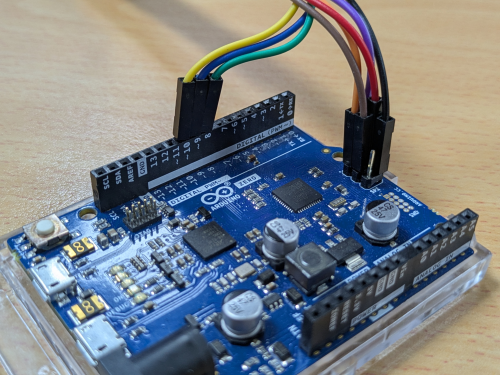
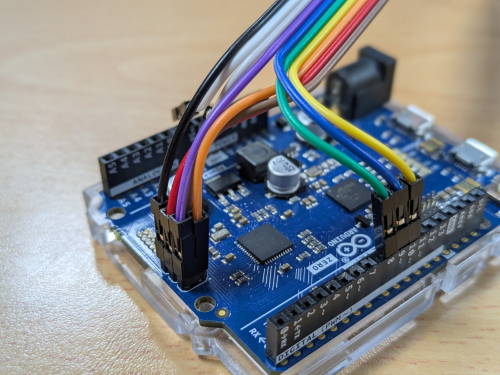

# EVE-MCU-Dev Ports for Arduino

[Back](../README.md)

The port for Arduino comprises a sketch to implement the MCU layer connecting to the EVE device via the SPI bus. 
The Arduino device manages the EVE device SPI bus. 

## Arduino Hardware

The Arduino port was developed using Arduino UNO, Arduino Zero and Arduino Leonardo modules. 
The Arduino module can be connected via short wires to the corresponding signals of an EVE module. 
Please reference the Arduino Datasheet for more information.

The following pictures are of a Arduino Zero module connected using the wire colours in [Module Connections](../../README.md#module-connections).

The pin connections for Arduino modules is as follows for the 2x8 and 1x10 connectors:

| Arduino Name | Arduino Pin | 2x8 Pin | 1x10 Pin | EVE Signal | Colour in Figure |
| --- | --- | --- | --- | --- | --- |
| SCLK | ICSP 3 | 1 | 1 | SCK | Brown 🟫 |
| COPI | ICSP 4 | 4 | 2 | MOSI | Red 🟥 |
| CIPO | ICSP 1 | 3 | 3 | MISO | Orange 🟧 |
| D10 | - | 2 | 4 | CS# | Yellow 🟨 |
| D8 | - | 14 | 5 | INT# _(1)_ | Green 🟩 |
| D9 | - | 13 | 6 | PD# | Blue 🟦 |
| - | ICSP 2 | 10 | 7 | 5V | Purple 🟪 |
| - | ICSP 6 / GND | 11/12 | 9/10 | GND | Black ⬛ |

- (1) The INT# line is not required for operation unless `EVE_COPRO_METHOD` macro is set with `EVE_COPRO_INT` in the configuration for EVE-MCU-Dev.

Ensure that the power supply from the Arduino module is capable of also powering the EVE board. If using third-party modules which may consume more current, a separate power connection to the EVE module could be used, with the grounds of the Arduino and EVE modules common to both power sources.

## SPI Transfer Frequency

The following table shows the SPI transfer frequencies for the Arduino port:

| Initialisation Phase | Runtime |
| --- | --- |
| 1 MHz | 8 MHz |

The maximum runtime speed of the SPI bus is reduced to support the legacy Arduino boards.
This may be increased in line with the supported SPI frequencies of more capable Arduino boards.

## Software

Please refer to the [Arduino Simple example](../../examples/simple/arduino/README.md) for instructions on using the hardware sketch in an EVE-MCU-Dev project.

Reference [Arduino Project](https://www.arduino.cc/)
