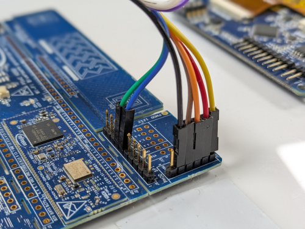

# EVE-MCU-Dev Port for Infineon PSoC 6

[Back](../README.md)

The port for Infineon PSoC 6 comprises the MCU connected to the EVE device via the SPI bus. The Infineon PSoC 6 device manages the EVE device SPI bus. 

This port is selected with the `PLATFORM_INFINEON_PSOC6` macro.

The [Infineon ModusToolbox Eclipse IDE](https://softwaretools.infineon.com/tools/com.ifx.tb.tool.mtbeclipse) is used for compiling the examples. The ModusToolbox handles the BSPs for each version of device. Calls are made to the Infineon ModusToolbox HAL to control the SPI, GPIO and timers.

> **Note:** The ModusToolbox Eclipse IDE requires that projects are included using a specific method. Please follow the instructions in the Infineon Knowledgebase article KBA236134.

## Requirements 

| Requirement | Details | 
| --- | --- | 
| Host operating system | Windows/Linux |
| Application architecture | Infineon ModusToolbox |
| Build environment | Infineon Eclipse IDE | 
| Platform definition | `PLATFORM_INFINEON_PSOC6` |
| Other | None |

## Hardware

The Infineon PSoC 6 port directly supports the following modules:
- [CY8CPROTO-062S2-43439](https://www.infineon.com/evaluation-board/CY8CPROTO-062S2-43439)

### Connection to EVE

The Infineon PSoC 6 module can be connected via short wires to the corresponding signals of an EVE module. Please reference the CY8CPROTO-062S2-43439 Datasheet for more information.

For new Infineon toolchain applications the pin definitions may be generated in the application rather than in this port. There are definitions in the port files which may override the definitions generated for a new application.

The following picture is of a CY8CPROTO-062S2-43439 module connected using the wire colours in [Module Connections](../../README.md#module-connections).



The pin connections for CY8CPROTO-062S2-43439 module is as follows for the 2x8 and 1x10 connectors:


| Infineon PSoC 6 Pin | Infineon PSoC 6 Pin Name | 2x8 Pin | 1x10 Pin | EVE Signal | Colour in Figure |
| --- | --- | --- | --- | --- | --- |
| 5.2 | P5_2 | 1 | 1 | SCK | Brown 🟫 |
| 5.0 | P5_0 | 4 | 2 | MOSI | Red 🟥 |
| 5.1 | P5_1 | 3 | 3 | MISO | Orange 🟧 |
| 5.7 | P5_7 | 2 | 4 | CS# | Yellow 🟨 |
| 5.6 | P5_6 | 14 | 5 | INT# _(1)_ | Green 🟩 |
| 5.5 | P5_5 | 13 | 6 | PD# | Blue 🟦 |
| N/A | VUSB | 10 | 7 | 5V | Purple 🟪 |
| N/A | GND | 11/12 | 9/10 | GND | Black ⬛ |

- (1) The INT# line is not required for operation unless `EVE_COPRO_METHOD` macro is set with `EVE_COPRO_INT` in the configuration for EVE-MCU-Dev.

Ensure that the power supply from the Infineon PSoC 6 module is capable of also powering the EVE board. If using third-party modules which may consume more current, a separate power connection to the EVE module could be used, with the grounds of the Infineon PSoC 6 and EVE modules common to both power sources.

## SPI

The following table shows the SPI transfer frequencies for the Infineon PSoC 6:

| Initialisation Phase | Runtime |
| --- | --- |
| 1 MHz | 24 MHz |

The EVE PD# and CS# pins are controlled by software using GPIOs. The CS# and PD# pins are setup as GPIO output pins with a "Low" output and no pull ups or pull downs, as they are controlled by software. 

The INT# pin is setup as a GPIO input with no pull ups or pull downs.

## Files

| File | Function |
| --- | --- |
| [EVE_MCU_PSOC6.c](EVE_MCU_PSOC6.c) | Common file for Infineon ModusToolbox, higher level read/writes, endian conversions, SPI peripheral setup and control, CS and PD pin control. |

## Compilation

The "platform" macro `PLATFORM_INFINEON_PSOC6` must be set to enable this port. All other platform macros must be undefined.

To set the ModusToolbox project to compile for the Infineon PSoC6 port there must be a line in the generated file `Makefile` for the project as follows:

```console
DEFINES+=PLATFORM_INFINEON_PSOC6
```

## Example Software

Please refer to the [Infineon Eclipse IDE Simple example](../../examples/simple/infineon-eclipse/simple/README.md) for instructions on using the port in an EVE-MCU-Dev project.
