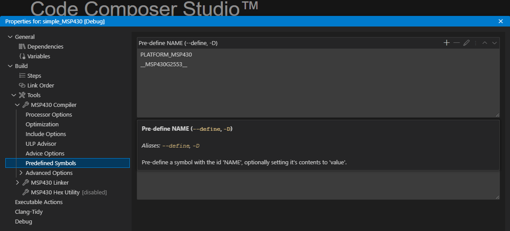

# EVE-MCU-Dev Ports for MSP

[Back](../README.md)

There are two separate ports for Ti MSP products:

| Port | PLATFORM macro | Port File |
| --- | --- | --- |
| [MSP430](#MSP430) | `PLATFORM_MSP430` | [EVE_MCU_MSP430.c](EVE_MCU_MSP430.c) |
| [MSPM0](#MSPM0) | `PLATFORM_MSPM0` | [EVE_MCU_MSPM0.c](EVE_MCU_MSPM0.c) |

The port for MSP430 and MSPM0 comprises the MCU connected to the EVE device via the SPI bus. The MSP device manages the EVE device SPI bus. 

## MSP430

### Requirements 

| Requirement | Details | 
| --- | --- | 
| Host operating system | Windows |
| Application architecture | MSP 16-bit RISC |
| Build environment | Texas Instruments CCS 20 | 
| Platform definition | `PLATFORM_MSP430` |
| Other | None |

### Hardware

The MSP430 port was developed using a MSP-EXP430G2 LaunchPad Development Kit. 

#### Connection to EVE

The MSP430 module can be connected via short wires to the corresponding signals of an EVE module. Please reference the MSP-EXP430G2 LaunchPad Development Kit Datasheet for more information.

| LaunchPad Pin | LaunchPad Pin Name | 2x8 Pin | 1x10 Pin | EVE Signal | Colour in Figure |
| --- | --- | --- | --- | --- | --- |
| P1.1 | J1 p1.4 | 1 | 1 | SCK | Brown 🟫 |
| P1.2 | J1 p1.2 | 4 | 2 | MOSI | Red 🟥 |
| P1.1 | J1 p1.1 | 3 | 3 | MISO | Orange 🟧 |
| P1.5 | J1 p1.5 | 2 | 4 | CS# | Yellow 🟨 |
| P1.6 | J1 p1.6 | 14 | 5 | INT# _(1)_ | Green 🟩 |
| P1.3 | J1 p1.3 | 13 | 6 | PD# | Blue 🟦 |
| N/A | J6 VCC | 10 | 7 | 5V | Purple 🟪 |
| N/A | J6 GND | 11/12 | 9/10 | GND | Black ⬛ |

- (1) The INT# line is not required for operation unless `EVE_COPRO_METHOD` macro is set with `EVE_TRANSFER_INT` in the configuration for EVE-MCU-Dev.

Ensure that the power supply from the MSP430 module is capable of also powering the EVE board. If using third-party modules which may consume more current, a separate power connection to the EVE module could be used, with the grounds of the MSP430 and EVE modules common to both power sources.

## SPI

The following table shows the SPI transfer frequencies for the MSP430:

| Initialisation Phase | Runtime |
| --- | --- |
| 1 MHz | 1 MHz |

The EVE PD# and CS# pins are controlled by software using GPIOs. The CS# and PD# pins are setup as GPIO output pins with a "Low" output and no pull ups or pull downs, as they are controlled by software. 

The INT# pin is setup as a GPIO input with no pull ups or pull downs.

## Files

| File | Function |
| --- | --- |
| [EVE_MCU_MSP430.c](EVE_MCU_MSP430.c) | Common file for MSP430, higher level read/writes, endian conversions, SPI peripheral setup and control, CS and PD pin control. |

## Compilation

The "platform" macro `PLATFORM_MSP430` must be set to enable this port. All other platform macros must be undefined.

To set the CCS 20 project to compile for the MSP430 the macro must be set in the the Properties dialog for the project.
This can be reached using the "Project" menu then "Properties". Next "Predefined Symbols" is selected. 
The macro is added to the "Pre-define NAME" section.

## Example Software

Please refer to the [MSP430 Simple example](../../examples/simple/MSP430/simple/README.md) for instructions on using the port in an EVE-MCU-Dev project.

## MSPM0

### Requirements 

| Requirement | Details | 
| --- | --- | 
| Host operating system | Windows |
| Application architecture | 32-bit Cortex-M0 |
| Build environment | Texas Instruments CCS 20 | 
| Platform definition | `PLATFORM_MSPM0` |
| Other | None |

### Hardware

The MSPM0 port was developed using a MSPM0 Development Kit. 

#### Connection to EVE

The MSPM0 module can be connected via short wires to the corresponding signals of an EVE module. Please reference a MSPM0 Development Kit Datasheet for more information.

Pins are defined in the example code using the CCS Studio configuration interface. Control pins for EVE are therefore marked as "N/A" in this table.

| LaunchPad Pin | LaunchPad Pin Name | 2x8 Pin | 1x10 Pin | EVE Signal | Colour in Figure |
| --- | --- | --- | --- | --- | --- |
| N/A | N/A | 1 | 1 | SCK | Brown 🟫 |
| N/A | N/A | 4 | 2 | MOSI | Red 🟥 |
| N/A | N/A | 3 | 3 | MISO | Orange 🟧 |
| N/A | N/A | 2 | 4 | CS# | Yellow 🟨 |
| N/A | N/A | 14 | 5 | INT# _(1)_ | Green 🟩 |
| N/A | N/A | 13 | 6 | PD# | Blue 🟦 |
| N/A | J6 VCC | 10 | 7 | 5V | Purple 🟪 |
| N/A | J6 GND | 11/12 | 9/10 | GND | Black ⬛ |

- (1) The INT# line is not required for operation unless `EVE_COPRO_METHOD` macro is set with `EVE_TRANSFER_INT` in the configuration for EVE-MCU-Dev.

Ensure that the power supply from the MSPM0 module is capable of also powering the EVE board. If using third-party modules which may consume more current, a separate power connection to the EVE module could be used, with the grounds of the MSPM0 and EVE modules common to both power sources.

## SPI

The following table shows the SPI transfer frequencies for the MSPM0:

| Initialisation Phase | Runtime |
| --- | --- |
| 1 MHz | 1 MHz |

The EVE PD# and CS# pins are controlled by software using GPIOs. The CS# and PD# pins are setup as GPIO output pins with a "Low" output and no pull ups or pull downs, as they are controlled by software. 

The INT# pin is setup as a GPIO input with no pull ups or pull downs.

## Files

| File | Function |
| --- | --- |
| [EVE_MCU_MSPM0.c](EVE_MCU_MSPM0.c) | Common file for MSPM0, higher level read/writes, endian conversions, SPI peripheral setup and control, CS and PD pin control. |

## Compilation

The "platform" macro `PLATFORM_MSPM0` must be set to enable this port. All other platform macros must be undefined.

To set the CCS 20 project to compile for the MSPM0 the macro must be set in the the Properties dialog for the project.
This can be reached using the "Project" menu then "Properties". Next "Predefined Symbols" is selected. 
The macro is added to the "Pre-define NAME" section as per the instructions in the [MSP430](#msp430) compilation section.

## Example Software

Please refer to the [MSPM0 Simple example](../../examples/simple/MSPM0/simple/README.md) for instructions on using the port in an EVE-MCU-Dev project.
