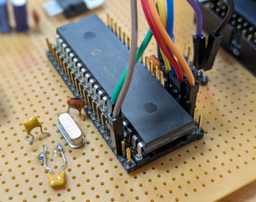
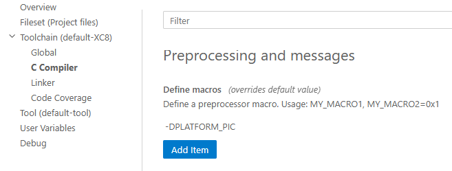

# EVE-MCU-Dev Ports for PIC18F

[Back](../README.md)

The port for PIC18F comprises the MCU connected to the EVE device via the SPI bus. The PIC18F device manages the EVE device SPI bus. 

## Requirements 

| Requirement | Details | 
| --- | --- | 
| Host operating system | Windows |
| Application architecture | PIC18F |
| Build environment | VSCode with MPLAB |
| Platform definition | `PLATFORM_PIC` |
| Other | None |

## Hardware

The PIC18F port was developed using a [Microchip PIC18F46K22](https://www.microchip.com/en-us/product/pic18f46k22). 

### Connection to EVE

The PIC18F module can be connected via short wires to the corresponding signals of an EVE module. Please reference the Microchip PIC18F46K22 Datasheet.

The following picture is of a 40-pin PIC18F46K22 PDIP package connected using the wire colours in [Module Connections](../../README.md#module-connections).

The pin connections for 40-pin PIC18F46K22 package is as follows for the 2x8 and 1x10 connectors:

| PIC18F46K22 PDIP Pin | PIC18F46K22 Pin Name | 2x8 Pin | 1x10 Pin | EVE Signal | Colour in Figure |
| --- | --- | --- | --- | --- | --- |
| 18 | RC3 | 1 | 1 | SCK | Brown 🟫 |
| 24 | RC5 | 4 | 2 | MOSI | Red 🟥 |
| 23 | RC4 | 3 | 3 | MISO | Orange 🟧 |
| 26 | RC7 | 2 | 4 | CS# | Yellow 🟨 |
| 17 | RC2 | 14 | 5 | INT# _(1)_ | Green 🟩 |
| 25 | RC6 | 13 | 6 | PD# | Blue 🟦 |
| N/A | VUSB | 10 | 7 | 5V | Purple 🟪 |
| N/A | GND | 11/12 | 9/10 | GND | Black ⬛ |

- (1) The INT# line is not required for operation unless `EVE_COPRO_METHOD` macro is set with `EVE_COPRO_INT` in the configuration for EVE-MCU-Dev. **NOTE:** This has not been tested on hardware.

Ensure that the power supply from the PIC18F module is capable of also powering the EVE board. If using third-party modules which may consume more current, a separate power connection to the EVE module could be used, with the grounds of the PIC18F and EVE modules common to both power sources.

## SPI

The following table shows the SPI transfer frequencies for the PIC18F port:

| Initialisation Phase | Runtime |
| --- | --- |
| 1 MHz | 1 MHz |

The SPI bus frequency is not increased for runtime on the PCI18F.
This can be changed if required in an application to suit the application.

The EVE PD# and CS# pins are controlled by software using GPIOs. The CS# and PD# pins are setup as GPIO output pins with a "Low" output and no pull ups or pull downs, as they are controlled by software. 

The INT# pin is setup as a GPIO input with no pull ups or pull downs.

## Files

| File | Function |
| --- | --- |
| [EVE_MCU_PIC.c](EVE_MCU_PIC.c) | MCU layer interface for interface setup, higher level read/writes, endian conversions, PD# pin control, INT# detection. |

## Compilation

The "platform" macro `PLATFORM_PIC` must be set to enable this port. All other platform macros must be undefined.

The macro must be set within the Microchip MPLAB VSCode extension. It can be set in the "Projects" section by clicking on "C Compiler" bookmark under "Toolchain (default-XC8)", or filtering on the term "Macro".

## Example Software

Please refer to the [PIC18F Simple example](../../examples/simple/PIC18F/README.md) for instructions on using the port in an EVE-MCU-Dev project.
