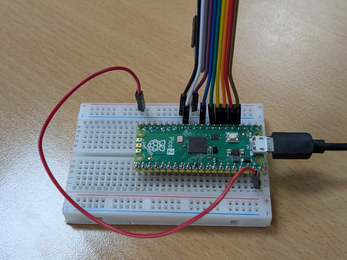
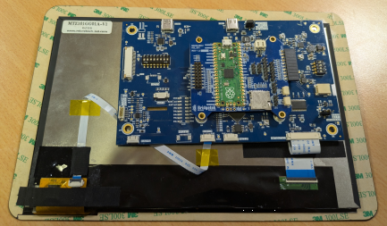
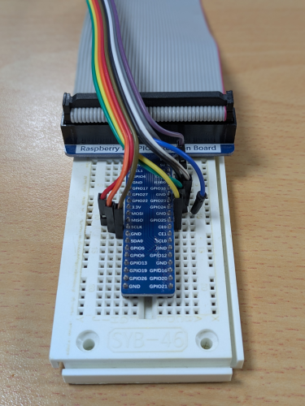
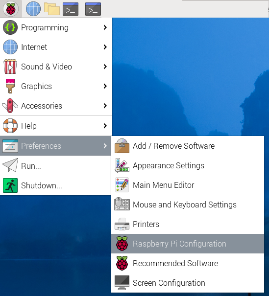
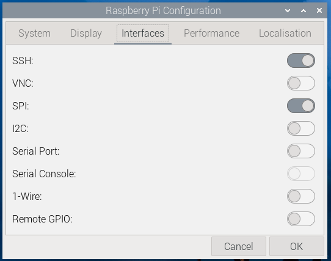
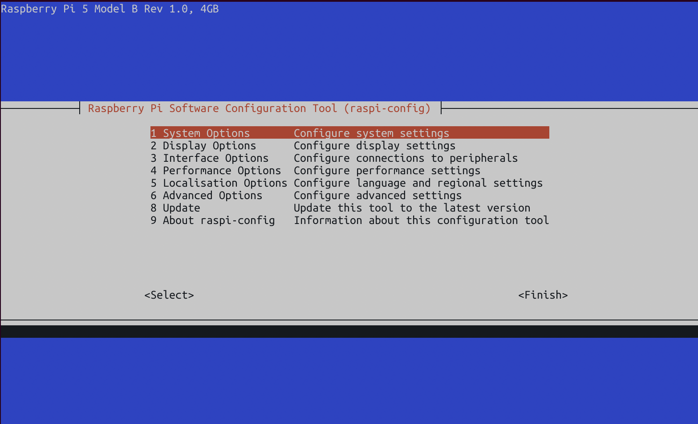

# EVE-MCU-Dev Ports for Raspberry Pi

[Back](../README.md)

There are two separate ports for Raspberry Pi products:

| Port | PLATFORM macro | 
| --- | --- | 
| [pico SDK](#hardware-pico-sdk) | `PLATFORM_PICO_SDK` _1_ | 
| [Raspberry Pi](#hardware-raspberry-pi) | `PLATFORM_RASPBERRYPI` | 

- (1) This has previously been called `PLATFORM_RP2040`. However, newer additions to the pico family maintain pin and source code compatibility this has been changed to reflect this. The old macro will still be supported for several release cycles.

## Hardware pico SDK

The pico port was developed using an Raspberry Pi "pico" with an RP2040 MCU. The "pico2" module using an RP2350 MCU is pin compatible. This code supports both modules with the board type selected in the `PICO_BOARD` environment string for "Board Type".

- For pico: `set(PICO_BOARD pico CACHE STRING "Board type")`
- For pico2: `set(PICO_BOARD pico2 CACHE STRING "Board type")`

The pico module can be connected via short wires to the corresponding signals of an EVE module. Please reference the Raspberry Pi pico Datasheet and pico2 Datasheet for more information. 

The following picture is of a pico module connected using the wire colours in [Module Connections](../../README.md#module-connections).



The pin connections for pico modules is as follows for the 2x8 and 1x10 connectors:


| Pico Pin | Pico Pin Name | 2x8 Pin | 1x10 Pin | EVE Signal | Colour in Figure |
| --- | --- | --- | --- | --- | --- |
| 4 | GP2 | 1 | 1 | SCK | Brown 🟫 |
| 5 | GP3 | 4 | 2 | MOSI | Red 🟥 |
| 6 | GP4 | 3 | 3 | MISO | Orange 🟧 |
| 7 | GP5 | 2 | 4 | CS# | Yellow 🟨 |
| 9 | GP6 | 14 | 5 | INT# _(1)_ | Green 🟩 |
| 10 | GP7 | 13 | 6 | PD# | Blue 🟦 |
| 40 | - | 10 | 7 | 5V | Purple 🟪 |
| 3/8/13 | - | 11/12 | 9/10 | GND | Black ⬛ |


- (1) The INT# line is not required for operation unless `EVE_COPRO_METHOD` macro is set with `EVE_COPRO_INT` in the configuration for EVE-MCU-Dev.

Ensure that the power supply from the Raspberry Pi pico module is capable of also powering the EVE board. If using third-party modules which may consume more current, a separate power connection to the EVE module could be used, with the grounds of the Raspberry Pi pico and EVE modules common to both power sources.

The MM2040EV is a Bridgetek board with a Raspberry Pi pico and a through-board 2x8 connector can be connected to an EVE board as in the following picture.



### SPI Transfer Frequency

The following table shows the SPI transfer frequencies for the pico SDK port:

| Initialisation Phase | Runtime |
| --- | --- |
| 1 MHz | 20 MHz |

### Files

| File | Function |
| --- | --- |
|[EVE_MCU_PICO_SDK.c](EVE_MCU_PICO_SDK.c) | Common file for Raspberry Pi pico SDK, higher level read/writes, endian conversions, SPI peripheral setup and control, CS and PD pin control. |

### IDM2040-7A Module

The IDM2040-7A from Bridgetek has an integrated Raspberry Pi RP2040 and a BT817Q. The screen resolution is 800x480.

The settings required in `EVE_config.h` are:
```c
#define EVE_DEVICE EVE_BT817
#define EVE_DISPLAY_RES EVE_IDM20407A
```

### IDM2040-43A Module

The IDM2040-43A from Bridgetek has an integrated Raspberry Pi RP2040 and a BT883. The screen resolution is 480x272.

The settings required in `EVE_config.h` are:
```c
#define EVE_DEVICE EVE_BT883
#define EVE_DISPLAY_RES EVE_IDM204043A
```

### IDM2040-21R Module

The IDM2040-21R from Bridgetek has an integrated Raspberry Pi RP2040 and a FT800Q. The screen resolution is 480x480.

The settings required in `EVE_config.h` are:
```c
#define EVE_DEVICE EVE_FT800
#define EVE_DISPLAY_RES IDM204021R
```

## Hardware Raspberry Pi

The Raspberry Pi port was developed using an Raspberry Pi Model B+ SBC. However it is compatible with all of the Raspberry Pi SBCs sharing the same 40-pin GPIO header. 

The Raspberry Pi can be connected via short wires to the corresponding signals of an EVE module. Please reference the Raspberry Pi documentation for more information.

A Raspberry Pi can be connected to an EVE board as in the following picture using the wire colours in [Module Connections](../../README.md#module-connections). __NOTE:__ The image does not show the correct wire colours. This will be updated soon.



The pin connections for pico modules is as follows for the 2x8 and 1x10 connectors:


| GPIO Header Name | GPIO Header Pin | 2x8 Pin | 1x10 Pin | EVE Signal | Colour in Figure |
| --- | --- | --- | --- | --- | --- |
| GPIO11(SCLK) | 23 | 1 | 1 | SCK | Brown 🟫 |
| GPIO10(MOSI) | 19 | 4 | 2 | MOSI | Red 🟥 |
| GPIO9(MISO) | 21 | 3 | 3 | MISO | Orange 🟧 |
| GPIO25 | 22 | 2 | 4 | CS# | Yellow 🟨 |
| GPIO23 | 16 | 14 | 5 | INT# _(1)_ | Green 🟩 |
| GPIO24 | 18 | 13 | 6 | PD# | Blue 🟦 |
| 5v Power | 2 | 10 | 7 | 5V | Purple 🟪 |
| Ground | 20 | 11/12 | 9/10 | GND | Black ⬛ |


- (1) The INT# line is not required for operation unless `EVE_COPRO_METHOD` macro is set with `EVE_COPRO_INT` in the configuration for EVE-MCU-Dev. **NOTE:** This has not been tested on hardware.

Ensure that the power supply from the Raspberry Pi SBC is capable of also powering the EVE board. If using third-party modules which may consume more current, a separate power connection to the EVE module could be used, with the grounds of the Raspberry Pi SBC and EVE modules common to both power sources.

### SPI Transfer Frequency

The following table shows the SPI transfer frequencies for the Raspberry Pi port:

| Initialisation Phase | Runtime |
| --- | --- |
| 1 MHz | 1 MHz |

### Files

| File | Function |
| --- | --- |
| [EVE_Linux_RPi.c](EVE_Linux_RPi.c) | Common file for Raspberry Pi Linux, higher level read/writes, endian conversions, SPI peripheral setup and control, CS and PD pin control. |

### Raspberry Pi SPI Setup

The SPI interface needs to be enabled in the "Raspberry Pi Configuration" settings. 

Open the start menu and select "Preferences" then "Raspberry Pi Configuration". 



Then select the "Interfaces" tab. The "SPI" interface can be enabled with the switch.



It is possible to enable the SPI using the `raspi-config` command line program.



Select "3" to configure the interfaces then enable the SPI interface in the next page.

### Raspberry Pi Link Library Setup

The `libgpiod` library will need to be installed on the Raspberry Pi to access the GPIO pins.

```console
sudo apt install libgpiod-dev
```
