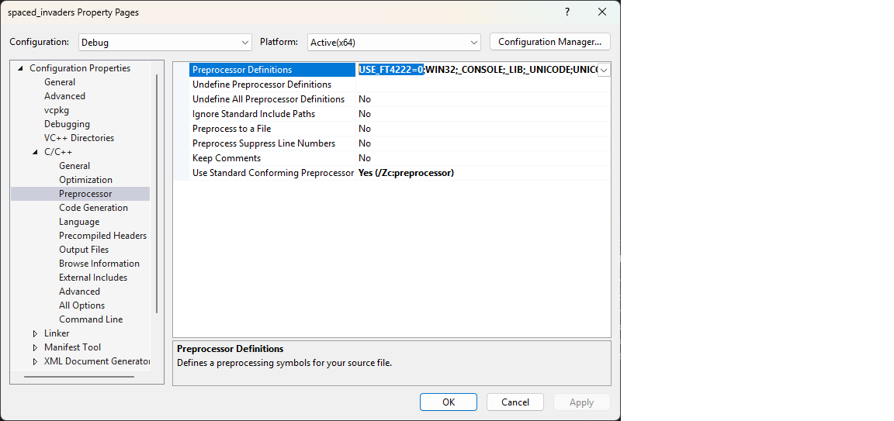

# EVE-MCU-Dev Ports for libft4222

[Back](../README.md)

The port for libft4222 comprises a host PC with a USB host controller connecting to the target EVE device through an FTDI FT4222H device. The FT4222H device manages the EVE device SPI bus. The host PC uses a library or DLL to manage the interface with the FT4222H device.

## Requirements 

| Requirement | Details | 
| --- | --- | 
| Host operating system | Windows/Linux |
| Application architecture | `x64` |
| Build environment | Visual Studio or a CMake-compatible toolchain | 
| Platform definition | `USE_FT4222` |
| Other | External FTDI Libraries |

## Hardware

This code requires an FT4222H adapter to connect to the EVE module. The FT4222H adapter is normally based around the [FTDI FT4222H](https://ftdichip.com/products/ft4222h/) USB bridging chip.

### UMFT4222EV-D

A popular solution which makes it easy to get up and running quickly is the FTDI [UMFT4222EV-D](https://ftdichip.com/products/umft4222ev/) module. 

The UMFT4222EV-D module uses the FT4222H chipset. 

#### Connection to EVE

The module can be connected to the associated pins of the EVE module using jumper wires.

| UMFT4222EV-D Name | UMFT4222EV-D Pin | 2x8 Pin | 1x10 Pin |EVE Signal |
| --- | --- | --- | --- | --- |
| SCK | JP5 Pin 9 | 1 | 1 | SCK |
| MOSI | JP5 Pin 7 | 4 | 2 | MOSI |
| MISO | JP5 Pin 8 | 3 | 3 | MISO |
| SSO0 | JP4 Pin 9 | 2 | 4 | CS# |
| GPIO2 | JP4 Pin 6 | 14 | 5 | INT# _(1)_ |
| GPIO0 | JP4 Pin 4 | 13 | 6 | PD# |
| VCC (5V) | JP4 Pin 1 | 10 | 7 | 5V |
| GND | JP4 Pin 3 / JP5 Pin 10 | 11/12 | 9/10 | GND |

- (1) The INT# line is not required for operation unless `EVE_COPRO_METHOD` macro is set with `EVE_COPRO_INT` in the configuration for EVE-MCU-Dev.

The adapter also provides a 5V power supply via the 5V pin on the header. Ensure that the computer has sufficient power to supply the EVE module when the backlight is on (and if the audio amplifier is used). If the PC cannot provide sufficient power, a separate power connection to the EVE module could be used, with the grounds of the UMFT4222EV-D and the separate power source common together to EVE. 

### MM4222-QSPI

Bridgetek offer the [MM4222-QSPI](https://brtchip.com/product/mm4222-qspi/) module, designed to support a range of host interfaces for Bridgetek EVE modules, including USB to SPI/QSPI. 

The MM4222-QSPI module uses the FT4222H chipset.

#### Connection to EVE

The module can be connected to the associated pins of the EVE module using jumper wires. It supports EVE module SPI/QSPI connections through a 10-pin / 2-pin (**CN2** / **CN3**) single-row socket or a 8x2 dual-row socket (**CN8**).

| MM4222-QSPI Name | CN2 pin | CN3 pin | CN8 pin | EVE Signal |
| --- | --- | --- | --- | --- |
| EVE_SCK | 1 | N/A | 1 | SCK |
| EVE_MOSI | 2 | N/A | 4 | MOSI |
| EVE_MISO | 3 | N/A | 3 | MISO |
| EVE_IO2 | N/A | 1 | 6 | I02 |
| EVE_IO3 | N/A | 2 | 5 | IO3 |
| EVE_CS# | 4 | N/A | 2 | CS# |
| EVE_INT# | 5 | N/A | 14 | INT# _(1)_ |
| EVE_RST# | 6 | N/A | 13 | PD# |
| VCC5V-Board | 7 | N/A | 10  | 5V |
| GND | 9 / 10 | N/A | 11 / 12 | GND |

- (1) The INT# line is not required for operation unless `EVE_COPRO_METHOD` macro is set with `EVE_COPRO_INT` in the configuration for EVE-MCU-Dev.

The adapter also provides a 5V power supply via the 5V pin on the header. Ensure that the computer has sufficient power to supply the EVE module when the backlight is on (and if the audio amplifier is used). If the PC cannot provide sufficient power, a separate power connection to the EVE module could be used, with the grounds of the MM4222-QSPI and the separate power source common together to EVE. 

### Modules 

The following modules contain both a USB to SPI bridge and an EVE device. No additional connections are required between the components.

#### ME812AU-WH50R Module

The [ME812AU-WH50R](http://brtchip.com/product/me812au-wh50r/) from Bridgetek has an integrated FT4222H and a FT812Q. The screen resolution is 800x480.

The settings required in `EVE_config.h` are:
```c
#define EVE_DEVICE FT812
#define EVE_DISPLAY_RES WVGA
```

#### VM816CU50A-D Module

The [VM816CU50A-D](https://brtchip.com/product/vm816cu50a-d/) from Bridgetek has an integrated FT4222H and a BT816Q. The screen resolution is 800x480.

The settings required in `EVE_config.h` are:
```c
#define EVE_DEVICE BT816
#define EVE_DISPLAY_RES WVGA
```

#### ME817EV Module

The [ME817EV](https://brtchip.com/product/me817ev/) from Bridgetek has an integrated FT4222H and a BT817Q.

The settings required in `EVE_config.h` are:
```c
#define EVE_DEVICE BT817
```

With an appropiate `EVE_DISPLAY_RES` settings for the attached LCD panel.

#### VM820C

The [VM820C](https://brtchip.com/product/vm820c/) Credit Card Module from Bridgetek has an integrated FT4222H and functions as the baseboard for development modules based on the **BT820B** IC.

The settings required in `EVE_config.h` are:
```c
#define EVE_DEVICE BT820
```

With an appropiate `EVE_DISPLAY_RES` settings for the attached LCD panel.

## SPI Transfer Frequency

The following table shows the SPI transfer frequencies for the libFT4222 port:

| Initialisation Phase | Runtime |
| --- | --- |
| 1.25 MHz | 20 MHz |

The CS# pin is controlled by the libFT4222 library.

The EVE PD# pin is controlled by software using GPIOs.The PD# pin is setup as GPIO output pin with a "Low" output and no pull ups or pull downs, as is is controlled by software. 

The INT# pin is setup as a GPIO input with no pull ups or pull downs.

## Files

| File | Function |
| --- | --- |
| [EVE_libft4222.c](EVE_libft4222.c) | MCU layer interface for interface setup, higher level read/writes, endian conversions, PD# pin control, INT# detection. |
| [libft4222.cmake](libft4222.cmake) | CMake recipe suitable for including in an application CMakeLists.txt file to include libFT4222 in a project. |
| [../external/ftdi_libraries/libFT4222](../external/ftdi_libraries/libFT4222) | Directory containing FT4222 libraries for Linux and Windows. |
| [../external/ftdi_libraries/libFTD2XX](../external/ftdi_libraries/libFTD2XX) | Directory containing D2XX libraries for Linux and Windows. |

## Compilation

The "platform" macro `USE_FT4222` must be set to enable this port. All other platform macros must be undefined.

The `USE_FT4222` macro holds the FT4222H channel to open. For example in the compiler command line the following would be a parameter to the compiler to select channel 0 on the FT4222 device.

```console
-DUSE_FT4222=0
```

In a CMake recipe the compile definition would be:

```cmake
add_compile_definitions(USE_FT4222=0)
```

A sample CMake recipe is included which can be used in a project to add the libFT4222 functionality. 

For Visual Studio this can be set in "Project Properties" -> "Configuration Properties" -> "C/C++" -> "Preprocessor" -> "Preprocessor Definitions":



### Windows

Important Information about Windows builds.

To compile this you will have to download the **LibFT4222** "middleware library" for Windows. The recommended version is v1.4.8 or later. The distributed files for this library are collected in the repository by Bridgetek for convenience: 

https://github.com/Bridgetek/FTDI-SW-Release/

This is used as a submodule for Windows compilations and is found in the directory `ports/external/ftdi_libraries`. Ensure that the repository has been cloned before compiling libft4222 builds.

### Linux

Important Information about Linux builds.

To compile this you will have to download the **LibFT4222** "middleware library" for Linux. The recommended version is v1.4.7 or later. It is available from the FTDI website:

https://ftdichip.com/software-examples/ft4222h-software-examples/

Download the latest version of the LibFT4222 library distribution. The file will typically have a name in the format `LibFT4222-linux-vx.x.x.yyy.zip` where *vx.x.x* is the version number. 

The library is installed *once* into the Linux file system. When building the example code the library files (H, DLL and LIB files) are found by the operating system.

#### Install the LibFT4222 Middleware Library in Linux

The LibFT4222 library distribution zip file must be extracted into a new directory. The new directory will have a file called `ReadMe.txt` which describes in detail how to install the library on a Linux system. 

Once the library is installed then the build will search the standard locations for include and library files.

## Example Software

Please refer to the [libft4222 Simple example](../../examples/simple/libft4222/README.md) for instructions on using the port in an EVE-MCU-Dev project.

