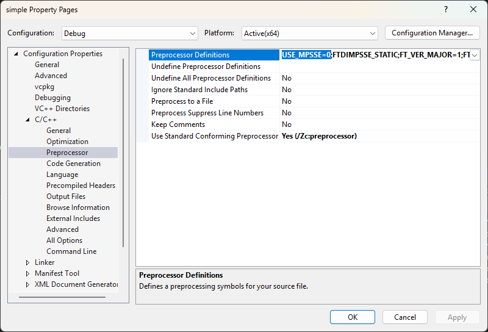

# EVE-MCU-Dev Ports for libmpsse

[Back](../README.md)

The libMPSSE port comprises a host PC with a USB host controller connected to the target EVE device through an FTDI MPSSE-capable device, such as the `FT232H`, `FT2232H`, or `FT4232H`. The FTDI device manages the EVE device SPI bus. The FTDI device manages the EVE SPI bus while the host PC communicates with the FTDI device using the `libMPSSE` and `D2XX` interfaces.

## Requirements 

| Requirement | Details | 
| --- | --- | 
| Host operating system | Windows/Linux |
| Application architecture | `x64` |
| Build environment | Visual Studio or a CMake-compatible toolchain | 
| Platform definition | `USE_MPSSE` |
| Other | External FTDI Libraries |

## Hardware

This code requires a USB-MPSSE adapter to connect to the EVE module. The USB-MPSSE adapter is normally based around the FTDI `FT232H` USB bridging chip.

### MPSSE Cables

A popular solution which makes it easy to get up and running quickly is the range of `C232HM` cables from FTDI such as [C232HM-EDHSL](https://ftdichip.com/products/c232hm-edhsl-0/) or [Connective Peripherals High Speed MPSSE Type-C](https://connectiveperipherals.com/products/usb-type-c-high-speed-mpsse).

The `C232HM` uses the `FT232H` chipset and has a 50cm cable with ten single pole receptacles. These can be connected to the associated pins of the EVE module.

#### Connection to EVE

For the versions of MPSSE cables with 5V output on the red wire (`C232HM-EDHSL` and `USBC-HS-MPSSE-5V-3.3V500-SPR`) the following wires can be used.

| MPSSE Cable Wire colour | 2x8 Pin | 1x10 Pin | EVE Signal |
| --- | --- |--- | --- |
| Orange 🟧 | 1 | 1 | SCK |
| Yellow 🟨 | 4 | 2 | MOSI |
| Green 🟩 | 3 | 3 | MISO |
| Brown 🟫 | 2 | 4 | CS# |
| Purple 🟪 | 14 | 5 | INT# _(1)_ |
| Blue 🟦 | 13 | 6 | PD# |
| Red 🟥 | 10 | 7 | 5V |
| Black ⬛ | 11/12 | 9/10 | GND |

- (1) The INT# line is not required for operation unless `EVE_COPRO_METHOD` macro is set with `EVE_COPRO_INT` in the configuration for EVE-MCU-Dev. The `INT#` signal is connected to the `ADBUS5` pin on the `FT232H` and is read using the low-byte GPIO functionality provided by the modified libMPSSE source used by this port. This allows the EVE interrupt-based co-processor completion method to be used.

If the version of the cable is used which has the 3.3V power output (or if using the 5V version but the EVE module requires more current than can be provided) then a separate power connection to the EVE module could be used, with the grounds of the `C232HM` / `USBC-HS-MPSSE` and the separate power source common together to EVE.

### VA800A-SPI Module

An alternative is the `VA800A-SPI` module can also be used in the same way as the `C232HM`. 
> **Note:** that the VA800A-SPI is now discontinued but the information is retained here for reference.

#### Connection to EVE

The `VA800A-SPI` has a 10-way connector and can be connected directly to the "VM" range of EVE modules such as the `VM800B`, `VM810C50A` and `VM816C50A`. Very short jumper wires can be used to connect it to other EVE modules by connecting the SCK, CS, MOSI, MISO, PD and GND connections. The adapter also provides a 5V power supply via the 5V pin on the header.

| VA800A-SPI | 2x8 Pin | 1x10 Pin | EVE Signal |
| --- | --- | --- | --- |
| CN1-1 | 1 | 1 | SCK |
| CN1-2 | 4 | 2 | MOSI |
| CN1-3 | 3 | 3 | MISO |
| CN1-4 | 2 | 4 | CS# |
| CN1-5 | 14 | 5 | INT# _(1)_ |
| CN1-6 | 13 | 6 | PD# |
| CN1-7 | 10 | 7 | 5V |
| CN1-8 | N/A | 8 | N/C |
| CN1-9 | 11/12 | 9 |GND |
| CN1-10 | 11/12 | 10 | GND |

- (1) The INT# line is not required for operation unless `EVE_COPRO_METHOD` macro is set with `EVE_COPRO_INT` in the configuration for EVE-MCU-Dev.

Ensure that the USB connection to the VA800A-SPI module has sufficient power to supply the EVE module when the backlight is on (and if the audio amplifier is used). If the PC cannot provide sufficient power, a separate power connection to the EVE module could be used, with the grounds of the `VA800A-SPI` and the separate power source common together to EVE. 

## SPI Transfer Frequency

The following table shows the SPI transfer frequencies for the libMPSSE port:

| Initialisation Phase | Runtime |
| --- | --- |
| 1 MHz | 15 MHz |

The CS# pin is controlled by the libMPSSE library.

The EVE PD# pin is controlled by software using GPIOs.The PD# pin is setup as GPIO output pin with a "Low" output and no pull ups or pull downs, as is is controlled by software. 

The INT# pin is setup as a GPIO input with no pull ups or pull downs.

> **Note:** The maximum reliable frequency for the SPI bus will depend on the wire length from the MPSSE device to the EVE device.

## Files

| File | Function |
| --- | --- |
| [EVE_libmpsse.c](EVE_libmpsse.c) | MCU layer interface for interface setup, higher level read/writes, endian conversions, PD# pin control, INT# detection. |
| [libmpsse.cmake](libmpsse.cmake) | CMake recipe suitable for including in an application CMakeLists.txt file to include libMPSSE in a project. |
| [../external/ftdi_libraries/libMPSSE](../external/ftdi_libraries/libMPSSE) | Directory containing MPSSE libraries for Linux and Windows. |
| [../external/ftdi_libraries/libFTD2XX](../external/ftdi_libraries/libFTD2XX) | Directory containing D2XX libraries for Linux and Windows. |


## Compilation

The "platform" macro `USE_MPSSE` must be set to enable this port. All other platform macros must be undefined.

The `USE_MPSSE` macro holds the MPSSE channel to open. For example in the compiler command line the following would be a parameter to the compiler to select channel 0 on the MPSSE device.

```console
-DUSE_MPSSE=0
```

In a CMake recipe the compile definition would be:

```cmake
add_compile_definitions(USE_MPSSE=0)
```

A sample CMake recipe is included which can be used in a project to add the libMPSSE functionality. 

For Visual Studio this can be set in "Project Properties" -> "Configuration Properties" -> "C/C++" -> "Preprocessor" -> "Preprocessor Definitions":



### FTDI Software Dependencies

This port uses files from the [Bridgetek FTDI-SW-Release](https://github.com/Bridgetek/FTDI-SW-Release) repository. The repository is included in EVE-MCU-Dev as a submodule under:

`ports/external/ftdi_libraries`

The following directories from the `FTDI-SW-Release` repository are used:

- `libMPSSE` - libMPSSE source and public header files.
- `libFTD2XX` - D2XX public header files and runtime dependencies.

Ensure that the `ftdi_libraries` submodule has been loaded or copied before building an example using this port.

#### Modified libMPSSE Source

The libMPSSE implementation used by this port contains modifications for EVE-MCU-Dev.

In particular, the GPIO read functionality has been extended so that `FT_ReadGPIO()` can read either the low or high byte of the MPSSE interface. This allows the EVE `INT#` signal connected to bit 5 of the selected MPSSE channel (`ADBUS5` or `BDBUS5`) to be read by the port.

Because these modifications are made to the libMPSSE source, the precompiled static libraries supplied in the `FTDI-SW-Release` repository do not contain the functionality required by this port and therefore **cannot be used**.

The following libMPSSE source files are compiled directly as part of the EVE-MCU-Dev build:

- `libMPSSE/source/ftdi_infra.c`
- `libMPSSE/source/ftdi_spi.c`
- `libMPSSE/source/ftdi_mid.c`

The corresponding header files are included from:

- `libMPSSE/include`
- `libFTD2XX/include`

This source-based build is used on both Windows and Linux.

The precompiled libMPSSE libraries are therefore not used:

- `libMPSSE.lib` on Windows.
- `libmpsse.a` on Linux.

The D2XX import/static libraries are also not linked directly by the EVE-MCU-Dev application. The libMPSSE implementation loads the appropriate D2XX shared library dynamically at runtime.

## Windows

### Build Requirements

Windows builds compile the modified libMPSSE source files from the `FTDI-SW-Release` repository directly into the application.

The following libraries are therefore **not required at link time**:

- `libMPSSE.lib`
- `ftd2xx.lib`

The public D2XX header files under `libFTD2XX/include` are still required when compiling the libMPSSE source.

### Runtime Requirements

The FTDI D2XX runtime is required.

The libMPSSE implementation dynamically loads:

`ftd2xx.dll`

when `Init_libMPSSE()` is called.

The appropriate FTDI D2XX driver must therefore be installed and `ftd2xx.dll` must be available to the application at runtime. On Windows, the required driver is generally installed automatically through Windows Update when the FTDI device is first connected.

No libMPSSE DLL is required because the libMPSSE implementation is compiled directly into the application.

## Linux

### Build Requirements

Linux builds use the same modified libMPSSE source files from the `FTDI-SW-Release` repository as the Windows build.

The following static libraries are therefore **not used**:

- `libmpsse.a`
- `libftd2xx.a`

The public D2XX header files under `libFTD2XX/include` are still required when compiling the libMPSSE source.

The Linux build also links against the platform dynamic-loading support required by `dlopen()`, `dlsym()` and `dlclose()`.

### Runtime Requirements

The FTDI D2XX runtime is required.

The libMPSSE implementation dynamically loads:

`libftd2xx.so`

when `Init_libMPSSE()` is called.

The appropriate FTDI D2XX driver must therefore be installed and `libftd2xx.so` must be available to the system dynamic loader at runtime.

The version of the FTDI D2XX driver may be important on some Linux distributions. A D2XX library compiled against a newer version of `glibc` cannot be loaded on a system using an older incompatible version. Version v1.4.33 has been tested on `Ubuntu` and is compiled for glibc version "GLIBC\_2.31".  Later versions require a system supporting "GLIBC\_2.34". If the glibc version is not supported then a message such as this will be reported.

For example, an incompatible D2XX runtime may result in an error similar to:

```console
sudo ./build/simple_libmpsse
dlopen failed: /lib/x86_64-linux-gnu/libc.so.6: version `GLIBC_2.34' not found (required by /usr/local/lib/libftd2xx.so)
source/ftdi_infra.c:254:Init_libMPSSE(): NULL expression encountered
```

If this occurs, install a version of the FTDI D2XX runtime compatible with the `glibc` version provided by the target Linux distribution.

## Example Software

Please refer to the [libmpsse Simple example](../../examples/simple/libmpsse/README.md) for instructions on using the port in an EVE-MCU-Dev project.

